# PMCS launcher

一个为 Windows 打造的 Minecraft: Java 版桌面启动器（当前版本 **2.11.1**）。界面使用 **Electron + React 19 + 原生 CSS** 编写，React 负责渲染根、窗口外壳与侧边栏，现有业务视图通过兼容桥接逐步迁移；支持从 **Mojang 官方版本库**下载原版游戏，创建 **原版 / Fabric / Forge / NeoForge / Quilt** 实例，并从 **Modrinth** 搜索、安装模组与前置依赖。

> 渲染进程：React 19 + esbuild；主进程：Electron/Node；安装器：C# WinForms。

## 下载

> 仓库为私有仓库，下载前需要拥有该仓库的访问权限。

- [PMCS launcher 2.11.1 安装程序](https://github.com/Wuliuqi0126/ol-launcher-releases/releases/download/v2.11.1/PMCSLauncher-2.11.1-Setup.exe)
- [PMCS launcher 2.11.1 便携版](https://github.com/Wuliuqi0126/ol-launcher-releases/releases/download/v2.11.1/PMCSLauncher-2.11.1-Portable.zip)
- [查看全部版本](https://github.com/Wuliuqi0126/ol-launcher-releases/releases)

安装包 SHA256 见对应 Release 说明。安装包未签名，Windows SmartScreen 可能提示，请选择“更多信息 → 仍要运行”。

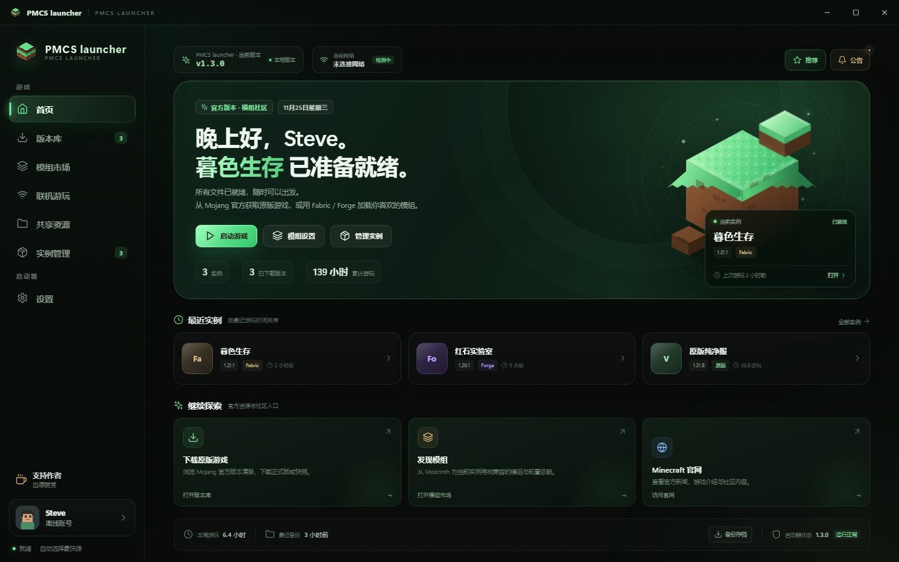

| 开屏动画 | 首次启动创建账户 |
| --- | --- |
| 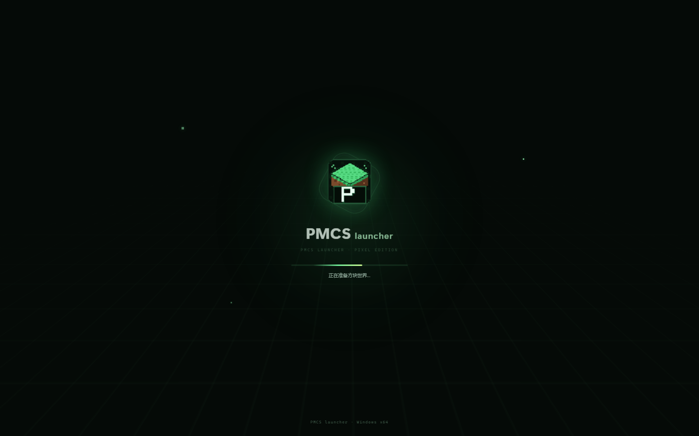 | 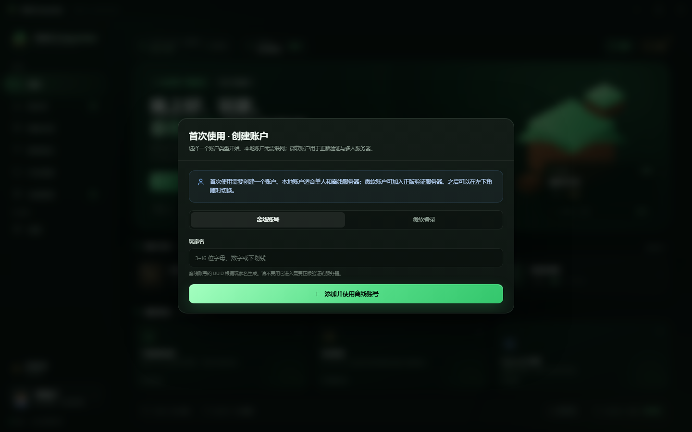 |

## 已实现功能

- **官方版本库**：读取 Mojang Piston 官方 `version_manifest_v2.json`，展示正式版、快照与远古版本；支持版本搜索、详情查看、完整下载。
- **开屏动画**：启动时显示像素风 Logo、流光进度条和网格光晕，最短 1.2 秒后平滑淡出，不阻塞启动流程。
- **首页概览**：当前实例卡片、最近实例、继续探索和底部状态栏；本周游玩来自本地游玩会话统计，最近备份读取 `backups/*.zip` 并支持一键备份当前实例存档。
- **首次启动创建账户**：没有账户时自动弹出「首次使用 · 创建账户」，可选本地离线账户或微软账户；不再默认生成 Steve，未创建账户前启动游戏会再次引导。
- **支持作者**：侧边栏「支持作者」与设置页「关于作者 / 赞赏作者」入口；微信、支付宝二维码可点击全屏放大，支持配置化渠道、图片加载降级和感谢名单，赞赏完全自愿且不绑定任何特权。
- **安装即配置联机防火墙**：安装程序自动添加启动器程序、UDP 24454 和 Java 局域网 TCP 端口的专用网络防火墙规则；卸载时自动移除。
- **本机游戏资源检索**：首次安装或更新后自动检索设备上已下载的游戏包体与模组，按“游戏包体 → 模组”顺序在右下角显示实时进度；分阶段成功提示和完成提示均可点击查看结果。设置页也提供“检索游戏包体资源”按钮，结果保存在 `resource-scan.json`，不会移动、修改或上传本地文件。
- **局域网正版验证修复**：客机提示“无效会话”时，主机可在联机页按加载器一键安装对应模组：Fabric/Quilt 使用 OfflineLAN，Forge/NeoForge 使用 LAN Server Properties；原版没有集成服务器开关，可直接选择独立服务端目录自动备份并修改 `server.properties`。
- **自动准备离线联机**：创建房间启动主机前，启动器自动检查并安装当前加载器对应的离线验证模组；Forge/NeoForge 同时写入 `config/lsp.json`，默认把 `onlineMode` 设为 `false`。联机页新增「一键改独立服务端」，不需要进入修复弹窗。
- **局域网房间总览**：加入房间会同时扫描 PMCS 房间和原版 Minecraft 局域网广播，显示房主、版本、存档名、模组数和实时延迟。
- **共享资源**：左侧新增独立「共享资源」页面，可共享存档、模组、资源包、光影和皮肤；客机可直接从房主下载缺失资源，SHA1 相同的文件自动跳过。
- **网络状态**：首页版本信息旁显示当前 Wi-Fi/网络名和同一网络中的启动器数量，点击可查看账户、主机和 IP 详情。
- **皮肤进入游戏**：皮肤库新增「应用到游戏」，自动安装 CustomSkinLoader、写入当前实例的本地皮肤目录，并修正 `CustomSkinLoader.json` 的 LocalSkin 优先级、清空旧缓存；支持 Fabric/Quilt/Forge/NeoForge。
- **托盘与关闭确认**：应用启动后显示系统托盘图标；关闭窗口时弹出上下两个单选项「最小化到托盘 / 退出 PMCS launcher」，并提供「记住该选项」和「之后可以在设置栏里更改」提示，底部为「暂不退出 / 退出启动器」。设置页的「关闭窗口时」可随时改回每次询问、最小化到托盘或直接退出。托盘菜单仍可重新显示主界面或彻底退出。
- **可选卸载清理**：卸载程序提供「同时删除本地游戏资源」「同时删除账户与启动器配置」「同时卸载 Tailscale」三个独立选项，默认保留存档与配置，并默认卸载 Tailscale；只删除程序文件时不会动 `游戏目录`。
- **退出时清理关联进程**：关闭启动器会终止所有 Minecraft/Java 游戏进程、Tailscale 登录子进程和局域网服务，避免残留后台进程占用文件导致无法卸载。
- **下载源测速**：自动并行测试 Mojang 官方、BMCLAPI、FastMinecraftMirror 三路速度，优先使用最快的源；设置中也可以手动锁定任意源。
- **256 线程并发下载**：游戏资源与依赖库各 256 路并行，针对 Minecraft 大量小文件减少网络等待；支持 HTTP Keep-Alive、超时重试和 `.part` 断点续传。
- **全量下载速度显示**：任务卡片统一显示实时速度、已下载 / 总大小和预计剩余时间，覆盖游戏核心、依赖库、资源文件、Java、Forge / NeoForge、模组、Tailscale 与共享存档。
- **大文件分片加速**：客户端 JAR、Java、模组等 ≥4 MB 文件自动切成最多 64 个 Range 分片并发，优先使用测速排名靠前的镜像，最后合并并做多重哈希校验；不支持 Range 的源自动回退单连接。
- **智能动态调度**：下载中实时监测速度，当前源连续低于阈值时自动中止并切换到其他镜像；已下载的分片通过 Range 继续，不从头重下。
- **完整文件校验**：优先校验 SHA-512，其次 SHA-256；Mojang 元数据只提供 SHA-1 的资源仍校验 SHA-1。所有可用哈希会一次读取完成校验，任何一项不匹配都会自动回退到下一个源。
- **多实例管理**：每个实例拥有独立的存档、模组、配置与日志；共享 `versions`、`libraries`、`assets`，节省磁盘空间。
- **局域网联机**：主机选择实例和存档后自动进入世界，在游戏内「对局域网开放」后自动检测端口；同一 Wi-Fi/热点下的设备通过启动器自动发现房间并一键加入，也支持手动输入 `IP:端口`。内置完整联机指引和故障排查。
- **进房前配置检查**：点击房间先对比版本、加载器、加载器版本和模组清单；缺失或版本不一致的模组标记为必须处理，可直接启动下载，资源包/光影/额外客户端模组只作为提示或警告，不严重的差异仍可进入。
- **启动前模组检查**：启动实例前读取 Forge/Fabric 模组元数据，检查 Minecraft 版本、加载器版本、必装前置、依赖版本和重复 modId；有阻断项时先提示并可禁用违规模组，只有警告/提示时仍可继续启动。
- **局域网共享存档**：自动识别本机所有实例、游戏目录和其他启动器目录中的存档；主机选择存档后通过局域网 HTTP 共享，客机自动发现并下载导入到指定实例，同名存档自动追加序号，不覆盖原存档。客机导入后会记录来源玩家、来源实例、主机名和下载时间。
- **实例存档列表**：实例管理页可直接打开该实例的存档列表，逐条标明「本地 / 共享」；共享存档额外显示来源玩家、来源实例、主机名和下载时间。
- **游戏输入法优化**：Windows 下启动游戏后关闭 Minecraft 窗口的中文输入法转换窗口，并切换到英文键盘布局；按 T 或 / 打开聊天/命令时切回中文输入法，发送或关闭聊天后再次关闭，避免游戏过程中弹出中文输入框。
- **光影加载器补充**：实例管理「模组设置 → 光影」新增「启用光影加载器」，旧实例也能一键安装 Iris + Sodium / Oculus + Rubidium。
- **联机可选光影**：客机加入前检查会把光影加载器、光影包和资源包列为可选下载项，其中光影加载器默认勾选，不下载也能进入。
- **主页推荐设置**：主页公告按钮旁新增“推荐”，集中提供关闭主机正版验证、一键安装 Sodium / Lithium / FerriteCore、下载 Java 21、局域网共享存档入口，并附带内存、版本一致和防火墙建议。
- **目录拆分与安全迁移**：设置分为「游戏目录（实例、存档等）」和「资源目录（模组、光影、整合包、皮肤等）」；更改时先复制、校验文件和大小，再删除旧目录，目标目录有无关文件时自动创建 PMCS 子文件夹。
- **模组市场扩展**：新增「整合包」和「材质包」模块，聚合 Modrinth + CurseForge 搜索，按来源展示；材质包直接安装到实例 `resourcepacks`，Modrinth 整合包自动创建匹配版本/加载器的实例并导入 `.mrpack`。
- **自动光影加载器**：创建实例时默认勾选「同时安装光影加载器」，Fabric/Quilt/NeoForge 自动安装 Iris + Sodium，Forge 1.16.5–1.20.1 自动安装 Oculus + Rubidium；没有兼容版本时跳过，不阻塞实例安装。
- **重复/跨版本模组清理**：实例模组页右键扫描重复 modId、重复 Fabric API 和不属于当前版本的 jar，确认后移入 `mods/.oasis-cleanup/` 备份目录。
- **内存安全限制**：滑块上限按系统物理内存的 75% 自动限制，超过 50% 时显示警告，避免把 16 GB 内存机器分配到 16 GB 堆。
- **手动模组登记**：手动放进 `mods` 的 jar 会自动写入 `.oasis-mods.json`，在模组列表里可识别、停用、清理。
- **离线账号日志降噪**：离线账号运行时隐藏 Realms、正版验证和 profile 401/429 相关日志。
- **加入前实例选择**：客机检查房间时可在「从已有实例中选择」和「创建全新实例并加入」之间选择；已有实例会标出最接近的配置和差异，新实例弹窗默认勾选主机必需模组并支持自定义名称。
- **共享存档联机标记**：主机开放局域网时会在存档写入联机标记；客机接收共享存档时如果检测到联机记录，会默认导入最近联机实例，并生成「主机名（日期 小时）共享存档」名称。
- **安全密钥联机**：主机生成自定义密钥名，10 分钟有效；密钥用 AES-GCM 加密 IPv6 地址、端口和房间信息，客机只有输入密钥才能读取房间并加入。主机勾选「重新激活密钥」后，同一密钥可继续使用。
- **IP 隐藏与隧道入口**：明文 IP 默认隐藏在「无法连接？点击这里直接获取 IP 地址」按钮中；Tailscale 和 playit 收进「无法联机？尝试隧道方式吧！」弹窗，不再占用联机主区域。
- **联机游玩**：左侧大厅入口改名为「联机游玩」，没有实例时也能搜索局域网房间，创建实例后再检查并加入。
- **主机资源下载**：客机缺少模组、资源包、光影时，可以通过密钥从主机地址下载，不要求同一局域网；下载按 SHA1 去重。
- **游戏内中文**：启动前自动把实例 `options.txt` 的语言设为简体中文；1.12 及更早版本自动使用 `zh_CN`。Minecraft 原生自带简体中文，模组汉化资源包可放入实例 `resourcepacks` 目录。
- **游戏内品牌名**：向游戏写入 `launcher_name` / `minecraft.launcher.brand`，在 F3 调试界面和崩溃报告中显示为「PMCS launcher」。
- **模组加载器**：
  - Fabric：从 FabricMC 官方元数据获取加载器版本并写入版本配置。
  - Forge：自动下载官方 Installer、准备 `launcher_profiles.json`、调用安装程序并解析生成的版本。
- **模组 / 光影 / 皮肤三模块**：模组与光影分别聚合 Modrinth + CurseForge，可按实例版本过滤；光影安装到 `shaderpacks`；皮肤库支持导入 64×64 / 64×32 PNG、预览、删除，并提供 NameMC / SkinMC / MinecraftSkins / Planet Minecraft 入口。支持 MCIM 国内镜像与中文搜索。
- **实例模组设置**：每个实例卡片都有「模组设置」，可查看并切换该实例已下载的模组、光影包和资源包；支持搜索、分类计数、打开对应目录。模组停用不会删除文件。
- **Java 运行时**：自动探测系统 Java；缺失时从 Eclipse Adoptium 下载 Temurin JRE；支持手动指定 `java.exe`。
- **离线与微软账号**：离线账号开箱即用；微软账号使用 OAuth 2.0 设备代码流，刷新令牌通过 Electron `safeStorage` 加密存储在本机。
- **启动与日志**：自动构建 classpath 与 JVM/游戏参数，支持旧版 `minecraftArguments`、资源虚拟化、natives 解压、日志配置；实时查看游戏输出。
- **任务进度**：安装版本、安装实例、下载 Java、启动游戏都有右下角进度卡片和错误提示；多任务按创建顺序稳定排列，进度更新只修改对应字段，不会反复重建卡片。
- **下载源**：自动测速（默认）/ Mojang 官方 / BMCLAPI / FastMinecraftMirror；第三方镜像只缓存 Mojang 文件，所有文件仍做 SHA-512 / SHA-256 / SHA-1 校验，模组仍走 Modrinth 官方 CDN。

| 版本库 | 模组市场 |
| --- | --- |
| 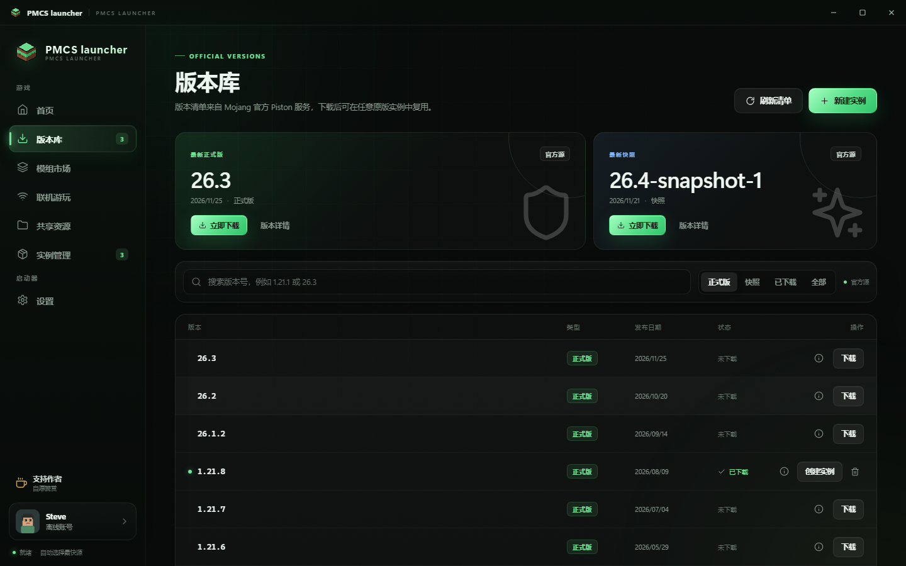 | 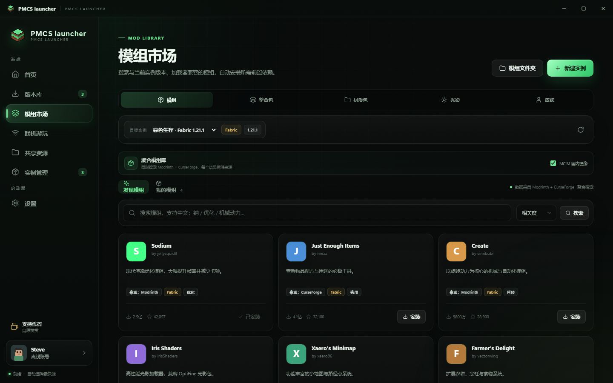 |

| 实例管理 | 设置 |
| --- | --- |
| 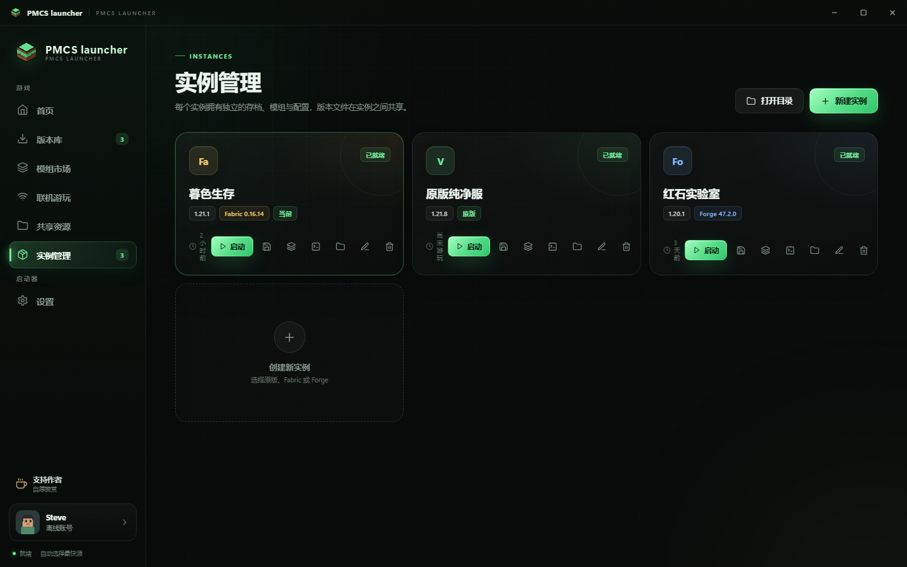 | 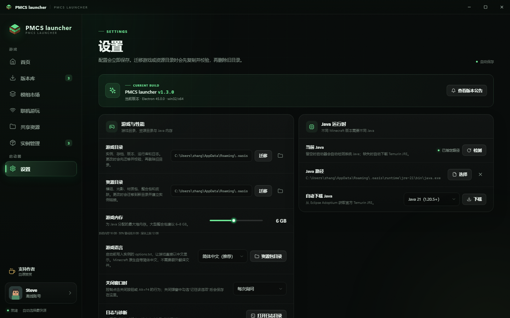 |

| 实例模组设置 |
| --- |
| 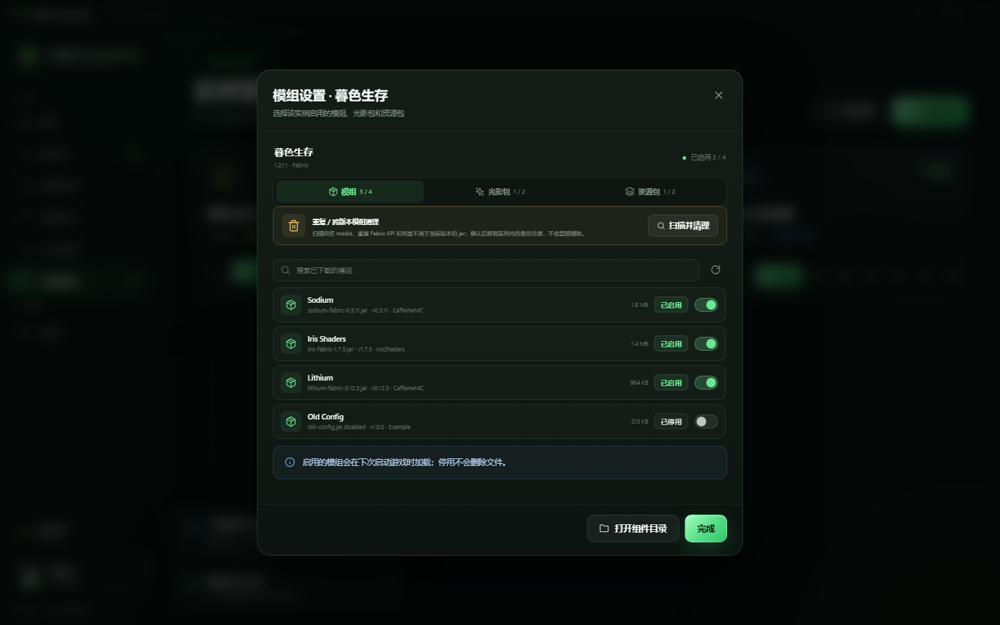 |

| 创建实例 | 微软账号登录 |
| --- | --- |
| 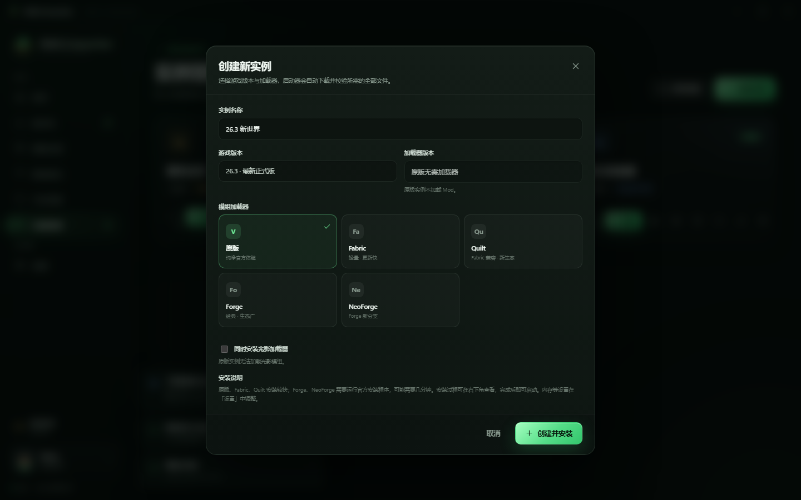 | 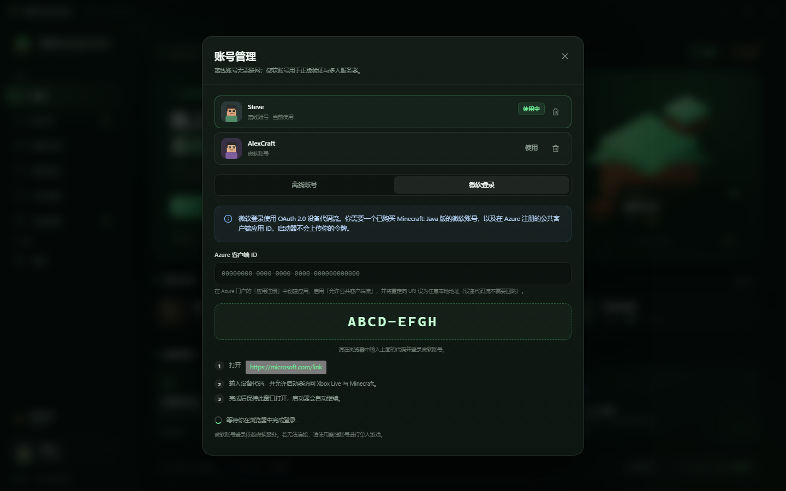 |

| 运行日志 | 下载任务 |
| --- | --- |
| 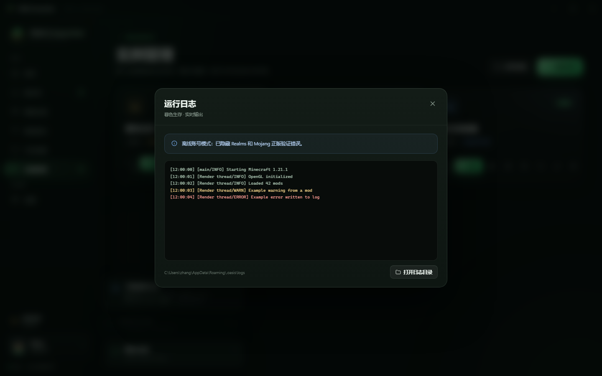 | 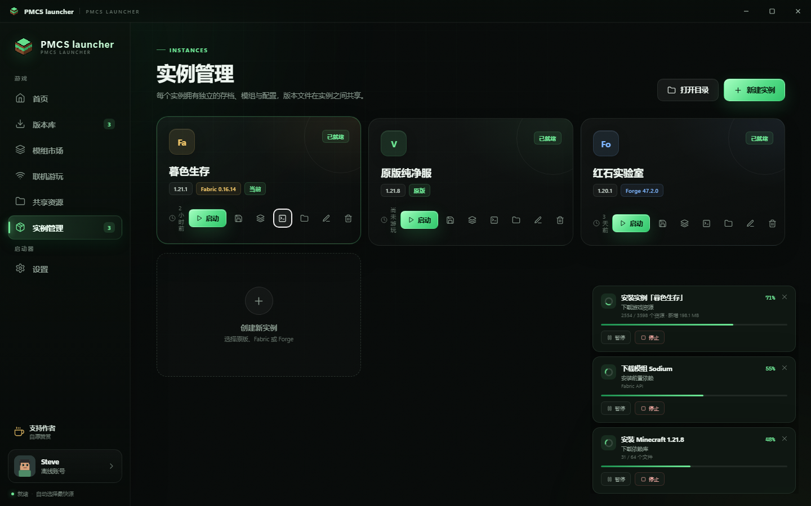 |

| 下载源测速 |
| --- |
| 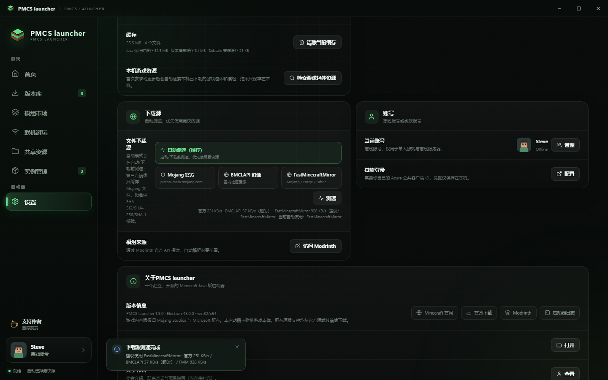 |

| 局域网联机：主机已开放 |
| --- |
| 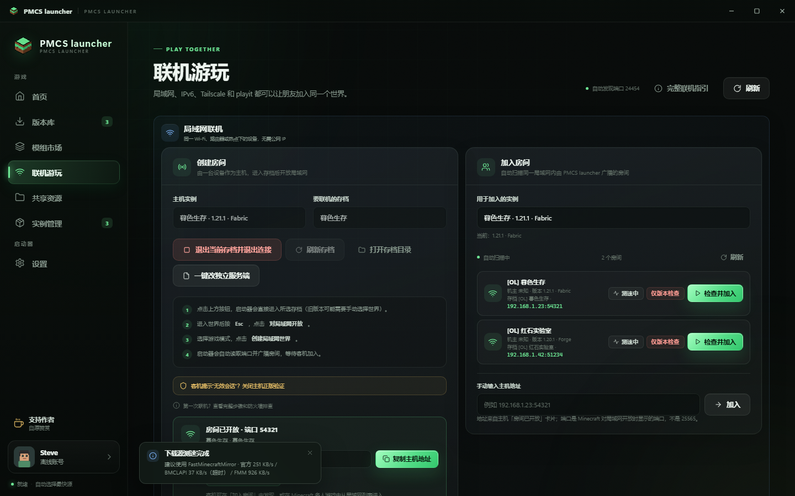 |

| 局域网联机完整指引 |
| --- |
| 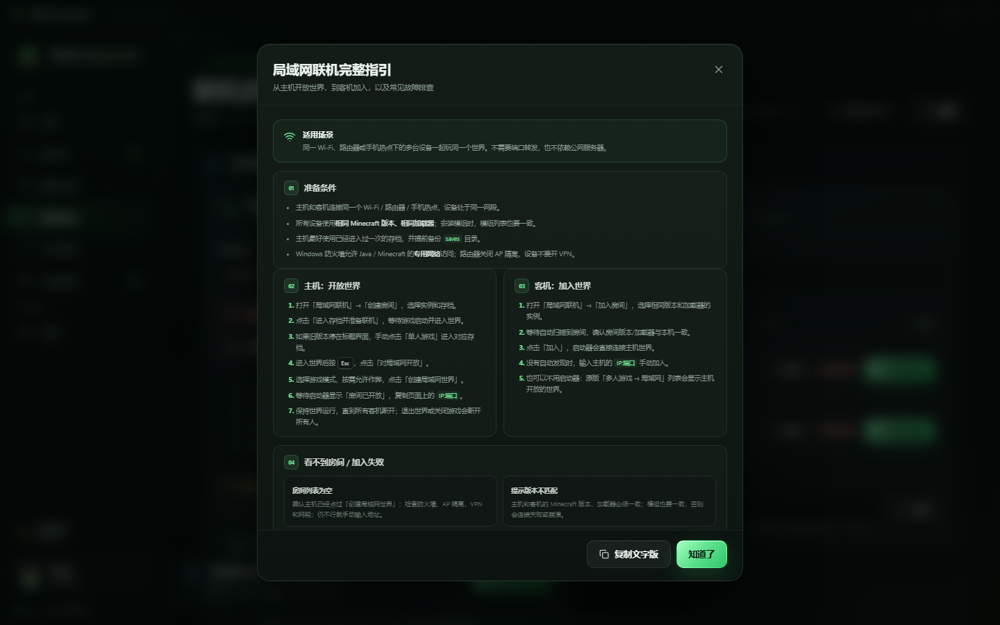 |

| Tailscale 外网联机 | Tailscale 操作指引 |
| --- | --- |
| 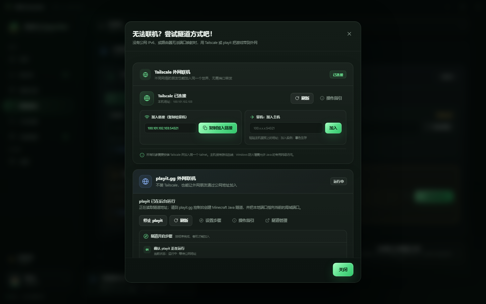 | 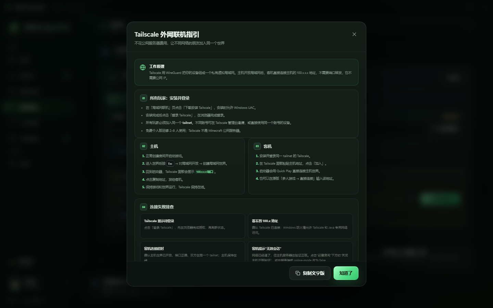 |

| playit.gg 外网联机 |
| --- |
| 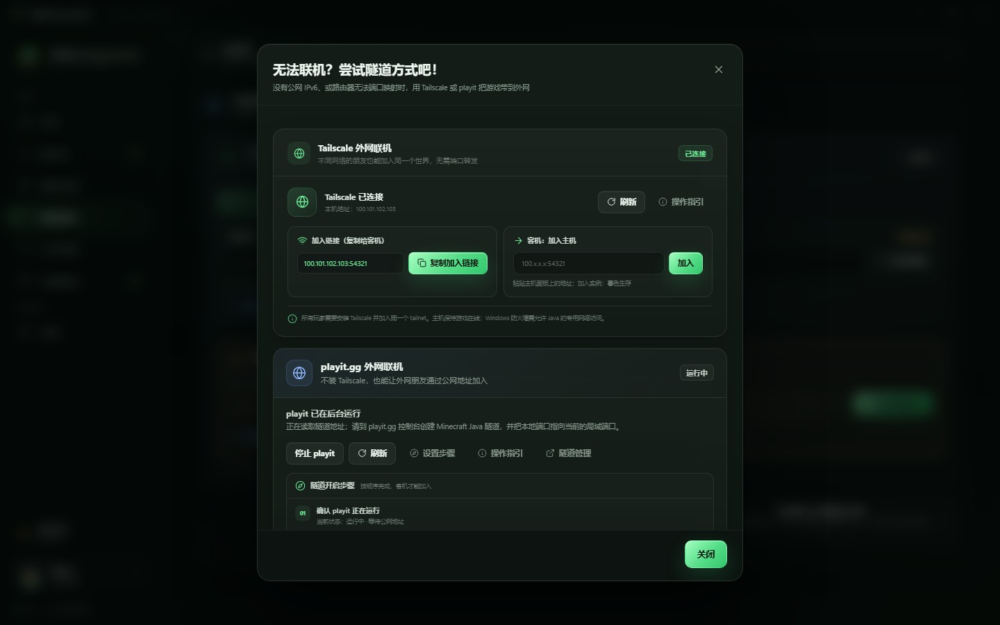 |

| 支持作者 | 二维码放大预览 |
| --- | --- |
|  |  |

## 版本更新规范

从 1.3.0 起，版本更新必须同时完成两件事：

1. 修改 `package.json` 的 `version`。
2. 在 `renderer/changelog.js` 最前面添加相同版本号的公告记录。

`scripts/build-renderer.js` 会自动执行 `scripts/check-changelog.js`。如果当前 `package.json` 版本没有对应公告，构建会直接失败，防止漏更新公告。

当检测到本地记录的公告版本与当前版本不一致时，启动器首次打开会自动弹出公告栏；记录保存在 Config 的 `announcementSeenVersion`，同一版本只自动弹出一次。

## 安装

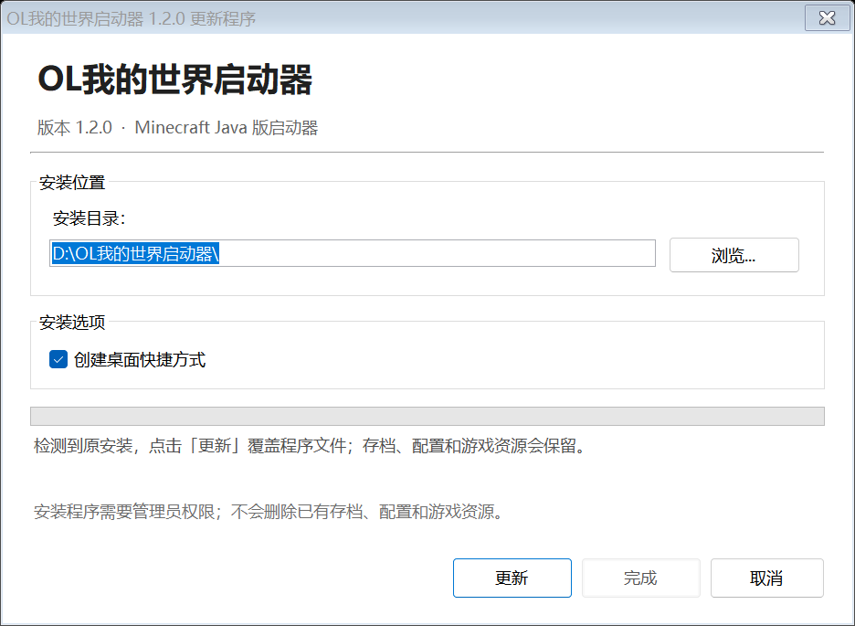


已构建的 Windows 一键安装包位于项目 `setup/`：

```
setup/PMCS launcher-2.11.1-安装程序.exe
```

双击后进入浅色原生 Windows 安装界面。选择父文件夹后，程序会安装到其下的 `PMCS launcher` 子文件夹；如果该子文件夹已存在则直接复用。默认安装到：

```
%LOCALAPPDATA%\Programs\PMCS launcher
```

如果检测到磁盘上已有旧版安装，安装器会直接把默认路径改为原安装目录，并以覆盖更新模式运行：只覆盖程序文件，不修改存档、配置、模组和游戏资源。

并自动创建桌面/开始菜单快捷方式，快捷方式名称为 **PMCS launcher**，安装后的主程序文件为：

``` 
PMCS launcher.exe
```

安装包文件名统一为 **PMCS launcher-2.11.1-安装程序.exe**。它不使用 NSIS/Inno Setup 的临时解压流程，所以不会再出现：

```
NSIS Error: Error writing temporary file
```

```
SHA256: 08887F4B00342140792DCE7DC8F6C87C0DD65987D071F2DABF3D46C8F2BD6C73
```

> 安装程序已内置 `requireAdministrator` 清单，双击后会先弹出 Windows UAC「用户账户控制」；允许后才会开始安装。`Uninstall.exe` 同样默认请求管理员权限，方便删除安装到受保护目录的文件。
>
> 安装界面为 600×400 固定窗口并启用 DPI 缩放；安装完成后原「启动」按钮改为「完成」，点击只关闭安装器，程序从桌面/开始菜单快捷方式启动。

卸载通过开始菜单或 Windows 应用的「卸载 PMCS launcher」完成；默认保留 `%APPDATA%\.oasis` 和 `D:\MC\游戏目录`，只有在卸载界面勾选「同时删除本地游戏资源」时才会清理；卸载界面默认勾选「同时卸载 Tailscale」。

如果系统仍然拦截，或者你想完全免安装，可以直接解压：

```
setup/PMCS launcher-2.11.1-便携版.zip
```

便携版 SHA256：

```
A9A0B66EDA44695834188739038986E8201BC8392B717DF21ADAE2130085DA87
```

之后所有新安装包统一输出到 `setup/`，不再放到桌面或 `dist/`。

### 命名规范（后续固定）

- 安装包文件名保持：`PMCS launcher-<版本>-安装程序.exe`
- 安装后的主程序：`PMCS launcher.exe`
- 桌面/开始菜单快捷方式：`PMCS launcher`
- 卸载项显示名：`PMCS launcher <版本>`
- 便携版压缩包名保持：`PMCS launcher-<版本>-便携版.zip`


安装包使用自主设计的绿色像素风图标，源文件位于 `assets/icon.png`、`assets/icon.ico`；安装器侧边图仍保留在 `assets/installer-sidebar.bmp`，供可选的美化版使用。

> **关于 SmartScreen：** 当前没有受信任的代码签名证书，因此无法从技术上保证“不出现拦截”。安装包/程序第一次运行时仍可能显示“Windows 已保护你的电脑”，点击「更多信息 → 仍要运行」即可。要彻底消除提示，需要购买受信任的代码签名证书（或上架 Microsoft Store）；自签名证书无效。一键安装器已经彻底移除 NSIS，因此 `Error writing temporary file` 不会再有，但 SmartScreen 是签名信誉问题，属于另一件事。
>
> 系统要求：Windows 10/11 x64。启动游戏需要能访问 Mojang 文件服务；下载源默认自动测速，也可以手动选择官方、BMCLAPI 或 FastMinecraftMirror。

## 从源码运行

环境：Node.js ≥ 22.12、npm。

```powershell
npm install
npm start
```

国内网络安装 Electron 较慢时，可先设置镜像：

```powershell
$env:ELECTRON_MIRROR = "https://npmmirror.com/mirrors/electron/"
npm install
```

### 打包安装程序

1.3.0 的最终安装器使用 **浅色原生 WinForms 安装界面**，不使用 NSIS，也不使用 Inno Setup 的临时解压流程：

- `setup-builder/OLSetup.cs`：读取自身尾部 ZIP，直接解压到用户选择的目录，不经过 `%TEMP%`。
- `setup-builder/SetupForm.cs`：浅色系统控件界面，包含安装目录、桌面快捷方式选项、进度和完成状态。
- `setup-builder/OLUninstall.cs`：独立卸载程序，提供「同时删除本地游戏资源」「同时删除账户与启动器配置」「同时卸载 Tailscale」选项；默认保留存档与配置，并会保护 `游戏目录`、Windows 和 Program Files。
- 安装后的主程序为 `PMCS launcher.exe`，快捷方式同名。
- 安装包文件名保持 `PMCS launcher-2.11.1-安装程序.exe`。
- 便携版 ZIP 同步使用新主程序名和 `Uninstall.exe`。

编译：

```powershell
C:\Windows\Microsoft.NET\Framework64\v4.0.30319\csc.exe /target:winexe /codepage:65001 `
  /win32icon:assets\icon.ico /win32manifest:installer\admin.manifest `
  /r:System.IO.Compression.dll /r:System.IO.Compression.FileSystem.dll `
  /r:System.Windows.Forms.dll /r:System.Drawing.dll /out:dist\OLSetup.exe `
  setup-builder\OLSetup.cs setup-builder\SetupForm.cs

C:\Windows\Microsoft.NET\Framework64\v4.0.30319\csc.exe /target:winexe /codepage:65001 `
  /win32icon:assets\icon.ico /win32manifest:installer\admin.manifest `
  /r:System.Windows.Forms.dll /r:System.Drawing.dll `
  /out:dist\Uninstall.exe setup-builder\OLUninstall.cs
```

把 `dist\Uninstall.exe` 放入安装 payload 后再压缩封装安装器。安装包支持：

```powershell
PMCS launcher-2.11.1-安装程序.exe /S /DIR="D:\Games\PMCS launcher"
```

electron-builder 和缓存保留在：

```text
E:\OLBuild\tools
E:\OLBuild\cache
```

构建配置在 `package.json` 的 `build` 字段，使用本地 `node_modules/electron/dist`。

## 使用流程

1. 打开「版本库」，选择正式版或快照并点击「下载」。首次下载包含游戏客户端、依赖库与约数百 MB 的资源文件。
2. 点击「新建实例」，选择游戏版本与加载器（原版 / Fabric / Forge），确认后自动安装。
3. 实例就绪后点击「启动游戏」。启动器会自动检测/下载 Java、解压 natives、补齐资源并启动。
4. 在「模组市场」选择目标实例，搜索并安装模组；安装时会自动处理所需的依赖库。
5. 在实例卡片上点击「模组设置」（层叠图标），可按分类启停该实例已下载的模组、光影包和资源包；也可以搜索或打开对应文件夹。
6. 在「设置」中调整内存、Java、下载源与账号；在实例卡片上可打开文件夹、查看日志、重命名或删除。
7. 在「设置 → 游戏语言」选择「简体中文」，启动器会在每次启动前写入实例的 `options.txt`，进入游戏后直接显示中文。

### 游戏内中文 / 汉化包

Minecraft Java 版本身内置简体中文，不需要额外下载完整汉化补丁。PMCS launcher 会把所选语言写入实例目录下的 `options.txt`：

- 1.13 及更新版本使用 `lang:zh_cn`。
- 1.12 及更早版本自动改用 `lang:zh_CN`。
- 选择「跟随游戏内设置」时，启动器不修改 `options.txt`。

如果安装的模组仍然是英文，需要下载该模组作者提供的**汉化资源包**（通常是一个 zip）。在「设置 → 游戏语言」点击「资源包目录」，把 zip 放进实例的 `resourcepacks` 文件夹，再在游戏内「选项 → 资源包」启用。启动器不会把英文模组自动翻译成中文。

### 游戏内显示名称

启动器会向 Java 进程写入：

```
-Dminecraft.launcher.brand=PMCS launcher
```

并同步设置版本参数里的 `launcher_name`。在 Minecraft 的 F3 调试界面、崩溃报告和部分日志中，启动器名称会显示为 **PMCS launcher**。

原版 Minecraft 的游戏窗口标题由游戏自身固定为 `Minecraft <版本号>`，不能通过启动参数修改；如果需要改窗口标题，需要额外的模组或窗口标题工具。启动器自己的窗口仍叫「PMCS launcher」。

### 局域网联机

适用场景：同一 Wi-Fi、路由器或手机热点下的多台电脑一起玩同一个世界，不需要端口转发，也不需要开公网服务器。

打开「局域网联机」后点击右上角「完整联机指引」，或点击页面中的「第一次联机？查看完整步骤和防火墙排查」，可以查看主机、客机、防火墙和常见故障的完整说明，并一键复制文字版发给朋友。

1. **所有设备准备相同环境**：安装相同 Minecraft 版本、相同加载器（原版/Fabric/Forge），并安装相同的模组。
2. **主机设备**：打开「局域网联机 → 创建房间」，选择实例和存档，点击「进入存档并准备联机」。启动器会使用 Quick Play 直接进入世界；旧版本可能需要手动选择世界。
3. **主机在游戏内开放**：进入世界后按 `Esc` → 对局域网开放 → 选择游戏模式 → 创建局域网世界。
4. 启动器会自动从游戏日志中读取端口，并在「房间已开放」卡片中显示 `本机IP:端口`；点击地址即可复制。
5. **客机设备**：打开「局域网联机 → 加入房间」，选择相同版本/加载器的实例，等待自动发现房间后点击「加入」；也可以手动输入主机地址，格式为 `192.168.x.x:端口`。
6. 客机也可以不使用 PMCS launcher：原版 Minecraft 的「多人游戏 → 局域网」列表里能看到主机开放的世界，直接加入即可。

说明：

- 自动发现使用 UDP `24454`，不占用 Minecraft 的 `4445`；安装程序会为专用网络添加启动器、UDP 24454 和 Java 局域网 TCP 端口的防火墙规则。如果网络被系统归类为“公用网络”，仍需改为专用网络或手动放行。
- 主机的 Minecraft 集成服务器端口由游戏随机分配，每次开放可能不同；启动器会自动更新。
- 主机和客机版本/加载器不一致时，客机界面会提示，并禁用「加入」按钮。
- 安装程序会自动放行启动器、UDP 24454 和 Java 局域网端口；如果仍无法连接，请确认 Windows 把当前网络识别为“专用网络”，并确认路由器没有开启 AP 隔离。
- 本功能只面向局域网，不穿透公网；跨网络联机请使用专用服务器或内网穿透工具。

### Tailscale 外网联机

适用于不同网络、没有公网 IP 的朋友，免费，不需要端口转发。Tailscale 用 WireGuard 组成私有虚拟局域网，主机保持游戏在线即可。

1. 在「局域网联机」页面找到「Tailscale 外网联机」。
2. 主机和客机都点击「下载安装 Tailscale」。Tailscale 官方 MSI 已合并进主安装包，启动器首次安装时直接使用内置包并校验 SHA256，不再单独下载；需要允许 UAC。
3. 安装完成后点击「登录 Tailscale」，在浏览器完成授权。所有玩家需要加入同一个 tailnet。如果浏览器没有自动打开，启动器会捕获 `tailscale up` 输出的登录链接并复制到剪贴板，手动粘贴到浏览器即可；也可以从 Tailscale 托盘图标点击 Log in。
4. 浏览器授权完成后，启动器会自动轮询登录状态，最长约 2 分钟；也可以立即点击面板上的「刷新」。读取到 `100.x.x.x` 后会直接显示「已连接」以及主机/客机接入选项，不会一直停在待登录。
5. 主机正常创建房间并在游戏内按 `Esc` → 对局域网开放。
6. 启动器的 Tailscale 面板会自动显示 `100.x.x.x:端口`，点击「复制加入链接」即可发给客机。
7. 客机把地址粘贴到 Tailscale 面板，点击「加入」；也可以在原版「多人游戏 → 直接连接」中输入。
8. 连接失败时，检查双方 Tailscale 是否在线、是否同一 tailnet、Windows 防火墙是否允许 Java 专用网络访问；主机必须保持世界运行。

限制：

- 主机必须保持在线，Tailscale 免费版不是 24 小时服务器。
- Tailscale 只负责网络连通，Minecraft 版本/加载器/模组仍需一致。
- 启动器不会自动创建 Tailscale 账号，登录授权由 Tailscale 官方网页完成。
- 安装包已内置 Tailscale 官方 MSI（约 37 MB）；卸载程序默认会一并卸载 Tailscale。
- 如果提示「未获取到登录链接」，通常是 Tailscale 服务处于 `NoState/Starting`。新版本会使用 `tailscale up --force-reauth` 强制获取新的登录链接；仍失败时以管理员身份运行 `Restart-Service Tailscale`，或从托盘选择 Log in。

### playit.gg 外网联机

playit.gg 是另一条不依赖公网 IP 的隧道方案，适合不想让客机安装 Tailscale 的场景。启动器已内置 playit 1.0.10 的 `playit-desktop.exe` 和 `playitd.exe`，首次使用不需要联网下载。

1. 在「局域网联机」页面找到「playit.gg 外网联机」，点击「准备 playit」；启动器会把内置组件复制到用户数据目录并校验 SHA256。
2. 点击「登录并绑定 playit」，浏览器会打开 `playit.gg` 授权页；没有账号可直接注册。完成授权后启动器会自动启动 playit 守护进程。
3. 主机正常创建房间并在游戏内按 `Esc` → 对局域网开放，启动器会显示当前本地端口。
4. 点击「隧道管理」，在 playit.gg 控制台创建 **Minecraft Java** 隧道，本地地址填写 `127.0.0.1:<当前端口>`。
5. playit 控制台会生成 `*.playit.gg:端口` 公网地址；复制给客机。
6. 客机不需要安装 playit，直接在 Minecraft「多人游戏 → 直接连接」输入该地址。

注意：

- playit 的公网地址由 playit.gg 控制台创建隧道后生成，启动器只负责本地组件、登录绑定和守护进程。
- 本地端口是 Minecraft 每次「对局域网开放」时随机生成的端口，不是 25565；重新开放世界后需要同步修改隧道。
- playit 是公网入口，建议只发给可信玩家，并在控制台设置访问限制。
- 免费隧道可能有延迟、带宽限制或地址变化；长期多人建议使用固定服务器。

### 微软账号登录

微软登录需要你自己的 Azure 应用 ID，启动器不内置任何第三方客户端 ID：

1. 打开 [Azure 应用注册](https://portal.azure.com/#view/Microsoft_AAD_RegisteredApps/ApplicationsListBlade)，新建应用。
2. 受支持的账户类型选择包含“个人 Microsoft 账户”。
3. 在「身份验证」中启用 **允许公共客户端流**（Allow public client flows），设备代码流不需要重定向 URI。
4. 复制「应用程序（客户端）ID」，填入启动器的账号管理 → 微软登录。
5. 点击「生成登录代码」，按提示在浏览器打开 `https://microsoft.com/link` 输入代码并授权。

微软账号必须已购买 Minecraft: Java 版。刷新令牌使用系统凭据加密后存储在 `%APPDATA%` 下的启动器配置中；访问令牌只保存在主进程内存中，不会发送到渲染页面。

### 下载很慢怎么办

1. 默认使用「自动测速」：启动器和每次下载前会并行测试 Mojang 官方、BMCLAPI、FastMinecraftMirror，选择实际最快的源，并在 2 分钟内复用测速结果（延迟与吞吐综合排序）。
2. 打开「设置 → 下载源」，点击「测速」可以立即比较三路速度，并手动锁定某个源。
3. 如果卡在 Java 下载：Java 来自 Eclipse Adoptium，和 Mojang 下载源无关。可以安装系统 Java 后在设置里选择 `java.exe`，避免重复下载。
4. Forge Installer 和 Modrinth 文件分别来自 MinecraftForge 与 Modrinth CDN，不走 Mojang 镜像；这两部分慢时只能更换网络环境。
5. 已经下载且校验通过的文件会自动跳过。中断后重新安装/修复即可接着补齐，不会从头下载。
6. 首次下载 1.20.1 的完整资源约 620 MB，按 2 MB/s 计算也需要约 5 分钟；任务卡片里的计数和百分比会持续更新。

### 模组库来源与国内资源

- **Modrinth**：直接连接官方 API；开启 MCIM 后使用 `mod.mcimirror.top` 的 Modrinth 兼容接口和文件镜像。
- **CurseForge**：通过 MCIM 的 CurseForge 兼容接口访问，启动器不内置 CurseForge API Key。
- **MCIM**：同时兼容 CurseForge/Modrinth API，可在模组市场顶部开关。
- **国内参考**：MC百科、BBSMC、MineBBS、MGC 中文图形站、MinecraftShaders；模组市场底部提供入口。CurseForge/Modrinth 本体文件仍按原项目许可证下载，Lss233's Mirror 主要面向开发期 Maven 依赖。

## 数据目录

默认游戏目录：`%APPDATA%\.oasis`（为兼容已有存档和实例，目录名沿用旧名）

```
.oasis/
├─ assets/            # 资源对象、资源索引、日志配置
├─ libraries/         # 依赖库与 natives
├─ versions/          # 官方版本 JSON/JAR、Fabric/Forge 版本配置
├─ runtime/           # 自动下载的 Java 运行时
├─ instances/         # 每个实例：mods、saves、config、日志等
├─ logs/              # 启动器、Forge 安装与游戏日志
├─ launcher/
│  ├─ library.json    # 实例清单
│  └─ version_manifest.json
└─ launcher_profiles.json  # 安装 Forge 时自动生成，供官方 Installer 使用
```

启动器自身配置位于 Electron 的 `userData` 目录（通常为 `%APPDATA%\PMCS launcher`）。从旧版 `ol-launcher`、`OL启动器` 或「绿洲启动器」升级时，首次启动会自动迁移配置、账号和联机组件。

## 项目结构

```
main/
├─ index.js        Electron 主进程、窗口与 IPC
├─ store.js        配置、游戏目录与实例持久化
├─ mojang.js       官方版本清单、版本 JSON、继承合并
├─ http.js         下载、重试、镜像、限流
├─ files.js        依赖库、资源、natives、日志配置
├─ loaders.js      Fabric / Forge 元数据与安装器
├─ installer.js    版本/实例安装编排
├─ launch.js       参数构建、Java 进程、日志流转发
├─ game-settings.js 游戏语言与 options.txt 写入
├─ java.js         Java 探测与 Adoptium 下载
├─ accounts.js     离线账号与微软设备代码登录
├─ modrinth.js     Modrinth 搜索、版本匹配、依赖安装
├─ components.js   实例模组、光影包、资源包启停
├─ tailscale.js    Tailscale 检测、下载安装、登录与 IP
├─ playit.js       playit.gg 内置组件、claim 绑定、隧道进程
├─ backup.js       当前实例存档 ZIP 备份与最近备份读取
└─ tasks.js        任务进度事件
renderer/          无框架渲染层（ES Modules + CSS）
preload.js         contextBridge 白名单 API
assets/            图标与安装器侧边图
installer/         旧 Inno/NSIS 脚本（不再使用）
setup/             生成的安装包（1.1.0 起统一输出到这里）
setup-builder/     浅色原生安装器源码
scripts/           无头 UI 测试、图标生成
```

### 安全边界

- 渲染进程启用 `contextIsolation`、关闭 `nodeIntegration`，只能调用 preload 中列出的 IPC。
- 外部链接只允许 `http/https`，由主进程用系统浏览器打开。
- 打开文件/目录时限制在游戏目录或启动器数据目录内。
- 微软账号令牌不会暴露给页面；账号接口返回的对象已剔除密钥字段。

## 已知限制

- 当前仅提供 Windows x64 安装包；代码中的部分路径处理已考虑 macOS/Linux，但未做平台打包验证。
- 加载器支持原版、Fabric、Forge、NeoForge、Quilt。
- 微软登录依赖 Azure 应用配置与微软服务可用性，无法在离线环境使用。
- 局域网联机依赖 Minecraft 自带「对局域网开放」，主机需要在游戏内完成这一步；安装程序会自动添加专用网络防火墙规则，但公用网络、AP 隔离或 VPN 仍可能阻止发现，此时改用手动地址。
- 游戏内中文通过设置 `options.txt` 实现；Minecraft 本身和原版界面会显示中文，第三方模组是否中文取决于作者是否提供汉化资源包。
- 实例模组设置通过 `.disabled` 后缀启停文件；光影包和资源包启用后仍需在游戏内对应菜单选择，且实例运行中不能切换（避免文件占用）。
- 第三方镜像只缓存 Mojang 文件，可能限速或失效；启动器不会提供盗版客户端，也不会绕过正版验证。下载仍会校验可用哈希，失败会自动回退到下一个源。
- 首次下载完整资源体积较大（例如 1.20.1 约 620 MB），速度取决于网络。启动器会跳过已存在且校验通过的文件。
- 安装包未签名，Windows SmartScreen 可能提示“未识别的应用”，可点击“更多信息 → 仍要运行”。

## 验证情况

- 使用无头 Chrome 对首页、版本库、模组市场、实例、设置、创建实例、账号、日志等界面完成渲染与交互截图，控制台无错误（`screenshots/`）。
- 多任务进度卡片经过交错更新测试：任务顺序保持不变、首个卡片 DOM 节点不被重建、进度/阶段文本正确刷新，不再因每次进度事件重新播放入场动画。
- 1.3.0 浅色 WinForms 安装器已验证：`TEMP/TMP` 指向不存在的目录、目标目录预置只读旧文件时，仍能安装并生成 `PMCS launcher.exe`；安装包包含带资源/配置/Tailscale 选项的 `Uninstall.exe`，并内置 Tailscale MSI；退出启动器时会调用游戏进程树清理。
- 下载源测速接口已用真实 Mojang 资源采样验证，并完成界面/结果展示测试。排序会综合吞吐和首字节延迟；测速结果缓存 2 分钟。FastMinecraftMirror 目前部分子域可能返回 404 或证书异常，探测失败会自动跳过，不会阻塞其他源。FastMirror 主要是服务端核心镜像，CMCL 使用 BMCLAPI，二者没有作为独立客户端资源源接入。
- 自动源下载链路已端到端验证：自动探测在官方/BMCLAPI/FMM 中选取最快源，下载 Gson JAR 并通过 SHA-1 校验；官方字段、资源对象、依赖库和客户端路径均会映射到镜像。
- 局域网联机链路已验证：`level.dat` 名称解析、存档列表、游戏日志端口识别（`Started serving on <port>`）、UDP 24454 房间广播/发现、Quick Play 单人/多人参数与旧版 `--server/--port` 回退。
- 游戏语言写入已验证：1.12 及更早映射为 `zh_CN`，1.13+ 映射为 `zh_cn`，保留 `options.txt` 其他设置并替换旧 `lang` 行。
- 局域网完整指引弹窗已通过无头 UI 测试，包含主机、客机、防火墙、AP 隔离、版本/模组不一致和端口变化排查，并支持复制文字版。
- 实例模组设置已通过 UI 与文件操作测试：模组 `.jar`、光影/资源包 `.zip` 的启用/停用、`.disabled` 后缀、路径穿越拦截、分类计数和空状态均正常。
- 后端冒烟测试覆盖：Mojang 1.20.1 完整下载（客户端/依赖库/资源）、Fabric 0.20.1 安装与启动、Forge 47.4.28 官方安装器与启动、Modrinth Sodium 搜索/安装/停用/启用、离线账号启动到进入世界。
- Electron 窗口在本构建环境的桌面会话中受运行环境限制无法启动，因此界面验证使用同一套渲染代码在 Chromium 中完成；实际 Electron 打包产物已生成并通过 asar 内容检查。

## 声明

本项目为独立开发的学习/实用项目，与 Mojang Studios、Microsoft、FabricMC、MinecraftForge、Modrinth 均无隶属关系。Minecraft 是 Microsoft 的商标。启动器不分发游戏本体，原版文件均从 Mojang 官方服务或其公开镜像下载；模组版权归各自作者所有。使用微软账号在线游戏需要拥有正版 Minecraft: Java 版。

## License

MIT
